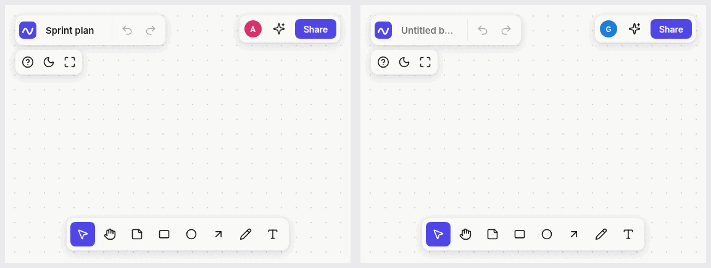
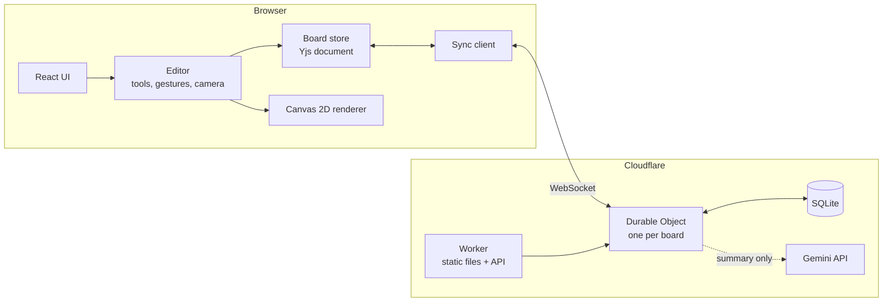

# Inkspace

**A multiplayer whiteboard: share a link and everyone edits the same board live.**

**Live demo:** _add your URL here after the first deploy_ (open it in two windows to see live sync)



Sticky notes, shapes, arrows, a pen and text on an endless canvas. No sign-up: a board is
a link. Everyone on it sees each other's cursors and edits as they happen, edits made
offline merge when the connection returns, and undo only reverts your own changes.

## Features

- **Live collaboration.** Edits, cursors, selections and even half-drawn pen strokes show
  up for everyone immediately.
- **Conflict-free.** Two people can move, recolour and type in the same note at once, or
  work offline. Both people's changes are kept and every copy of the board ends up identical.
- **Arrows that stay attached.** Draw an arrow from one shape to another and it follows them
  when either is moved, by anyone.
- **Templates.** Start from a brainstorm, retrospective, kanban or flowchart board, each
  previewed on the home page by the same renderer as the board itself.
- **Follow mode.** Click someone's avatar and your view follows theirs as they pan and zoom,
  for presenting or walking someone through a board.
- **A real canvas editor.** Pan and zoom, marquee select, move, resize, duplicate,
  reorder, keyboard shortcuts, touch pinch zoom, light and dark themes.
- **Per-person undo.** Undo and redo step through your own edits and leave everyone
  else's alone.
- **Share links without accounts.** One link lets people edit, another lets them only
  watch, and the server enforces the difference. The board's creator can reset the edit link
  at any time, which cuts off everyone using the old one. Still no sign-up.
- **Saved automatically.** Boards are still there days later.
- **AI summary (optional).** One button turns the notes into a summary, themes and action
  items, and can drop the action items onto the board as new sticky notes.
- **PNG export** of the whole board.

## How it works



The interesting parts, with pointers into the code:

### Conflict handling with a CRDT

The board is a [Yjs](https://yjs.dev) document. Each shape is its own map inside it, so
edits to different properties of one shape merge instead of overwriting each other: one
person moves a note while another recolours it, and both changes survive. A note's text
is a shared text type, so two people typing in it are merged character by character. Because merging
is built into the data structure, being offline needs no special code. Edits apply
locally, and on reconnect the two sides exchange whatever the other is missing.
([`src/board/store.ts`](src/board/store.ts))

### A hand-written sync server on Durable Objects

Each board is one Cloudflare Durable Object holding the document and its WebSockets
([`worker/board-room.ts`](worker/board-room.ts)).

- **Hibernation.** The object is evicted from memory whenever nobody is sending anything,
  while the sockets stay open. Anything that must survive that lives in SQLite or in
  per-socket attachments, not in fields.
- **Batched persistence.** A drag is hundreds of tiny edits. They are merged and written
  as one row per second, and every 50 rows are folded into a single snapshot.
- **Stateless presence.** The server keeps no cursor state. It relays presence, remembers
  which socket owns which presence id, and announces a departure when a socket closes.

### A hand-written sync client

[`src/board/sync-client.ts`](src/board/sync-client.ts) speaks the Yjs sync protocol over
one WebSocket, reconnects with exponential backoff and jitter, and keeps the connection
alive with a ping the server answers without waking the board. It replaced an off-the-shelf
client that re-broadcast every presence update it received, multiplying traffic.

### Arrows that follow shapes, with nothing extra to sync

An arrow attached to a shape does not store where that end is. It stores the shape's id, and
every client works out the end point from where the shape is now
([`resolveArrow` in `src/board/store.ts`](src/board/store.ts)). So when someone moves a shape,
only the shape's position is sent, and every arrow attached to it follows on every screen.
There is no second edit that could arrive late or conflict with someone else's.

### The canvas editor

No whiteboard SDK and no canvas library. The editor
([`src/board/editor.ts`](src/board/editor.ts)) knows nothing about the DOM: it receives
plain pointer input and exposes state, so every gesture (drag to create, marquee, resize,
arrow endpoints, pen strokes) is unit tested without a browser. Geometry, hit-testing and
stroke simplification are pure functions ([`src/board/geometry.ts`](src/board/geometry.ts)),
and the renderer draws from that state onto a Canvas 2D context
([`src/board/render.ts`](src/board/render.ts)).

Pen strokes are streamed to other people while they are being drawn, over the same
short-lived presence channel as cursors, then simplified and saved to the document once
on release.

### Share links, and revoking them, without accounts

Creating a board generates a random owner key that stays in the creator's browser. Everything
else is derived from it with one-way hashes ([`shared/boardKey.ts`](shared/boardKey.ts)):

```
owner key  --hash-->  edit token  --hash-->  board id
```

| Link                   | Lets you                      |
| ---------------------- | ----------------------------- |
| `/b/<id>#<owner key>`  | edit, and reset the edit link |
| `/b/<id>#<edit token>` | edit                          |
| `/b/<id>`              | watch, read-only              |

The server checks a key by hashing it, so a new board needs nothing stored about who may do
what, and no link can be upgraded to a stronger one. To revoke edit access, the owner derives
the next edit token from their key and tells the server its hash. Old edit links stop working
at once, including for people connected at that moment, and the owner can always produce the
current link again from their key alone.

### AI as a small, optional extra

The Worker calls Gemini with a JSON schema and returns a typed result
([`worker/ai.ts`](worker/ai.ts)). The API key stays on the server. The server summarizes
its own copy of the board rather than text sent by the client, so the endpoint cannot be
used as a general AI proxy. It is rate limited per visitor and per board, identical
requests are served from cache, and if there is no key or the AI is down, only the summary
panel is affected.

### Built to run for free

Everything runs on Cloudflare's free plan with no credit card: one Worker serves the
frontend, the API and the Durable Objects. The free plan's daily limits shaped the
design: cursor updates are throttled to 20 a second, saves are batched, and idle boards
hibernate.

## Tech stack

React, TypeScript, Vite, Yjs, Canvas 2D, Cloudflare Workers and Durable Objects (SQLite),
Gemini API, Vitest, Playwright.

## Run it locally

Requires Node.js 22 or newer.

```bash
npm install
cp .dev.vars.example .dev.vars   # local settings; turns on the mock AI summary
npm run dev
```

Open http://localhost:5173, create a board, and open its link in a second window. The
whole app, including the Worker and Durable Objects, runs locally; no account is needed.

The AI summary has three modes, set by `GEMINI_API_KEY` in `.dev.vars`:

| Value      | Behaviour                                                        |
| ---------- | ---------------------------------------------------------------- |
| `mock`     | Returns a canned summary without calling anything (the default)  |
| a real key | Calls Gemini. Free keys: https://aistudio.google.com/apikey      |
| not set    | The Summarize panel says AI is not set up; everything else works |

## Tests

```bash
npm test             # unit tests (Vitest)
npm run test:e2e     # browser tests (Playwright), against the real local server
npm run typecheck
npm run lint
```

The first time, install the test browser with `npx playwright install chromium`.

The browser tests open the same board in separate browser contexts and check, among other
things, that a change in one window shows up in the other, that offline edits merge after
reconnecting, that undo only reverts your own changes, that the server refuses writes from
a view-only link, and that resetting the edit link cuts off people using the old one.

## Deploy

Deployment is free and needs no credit card.

### First deploy, from your machine

1. Create a free Cloudflare account at https://dash.cloudflare.com/sign-up.
2. Log in and deploy:

   ```bash
   npx wrangler login
   npm run deploy
   ```

   Wrangler prints the URL, for example `https://inkspace.<your-subdomain>.workers.dev`.

3. Optional: turn on the AI summary with a free Gemini key from
   https://aistudio.google.com/apikey:

   ```bash
   npx wrangler secret put GEMINI_API_KEY
   ```

### Automatic deploys from GitHub

The workflow in [`.github/workflows/ci.yml`](.github/workflows/ci.yml) runs all tests on
every push and pull request, and deploys pushes to `main` once the tests pass. Add two
repository secrets under **Settings → Secrets and variables → Actions**:

| Secret                  | Where to get it                                                                                    |
| ----------------------- | -------------------------------------------------------------------------------------------------- |
| `CLOUDFLARE_API_TOKEN`  | Cloudflare dashboard → My Profile → API Tokens → Create Token → "Edit Cloudflare Workers" template |
| `CLOUDFLARE_ACCOUNT_ID` | `npx wrangler whoami`, or the Workers overview page in the dashboard                               |

Until both exist, the deploy job passes without deploying. The Gemini key is not a GitHub
secret: it is stored in Cloudflare by the `wrangler secret put` command above and survives
deploys.

## Project structure

```
src/board/        Editor, store, renderer, geometry, presence, sync client (no React)
src/components/   React components: canvas, toolbar, panels
src/pages/        Home page and board page
src/lib/          Routing, theme, identity, recent boards
shared/           Code used by both the browser and the Worker
worker/           Cloudflare Worker: API, Durable Object, AI
tests/e2e/        Playwright tests
```

## Known limitations

- The owner link cannot be revoked, so whoever has it controls the board. Keep it private.
- The list of recent boards lives in the browser, not in an account.
